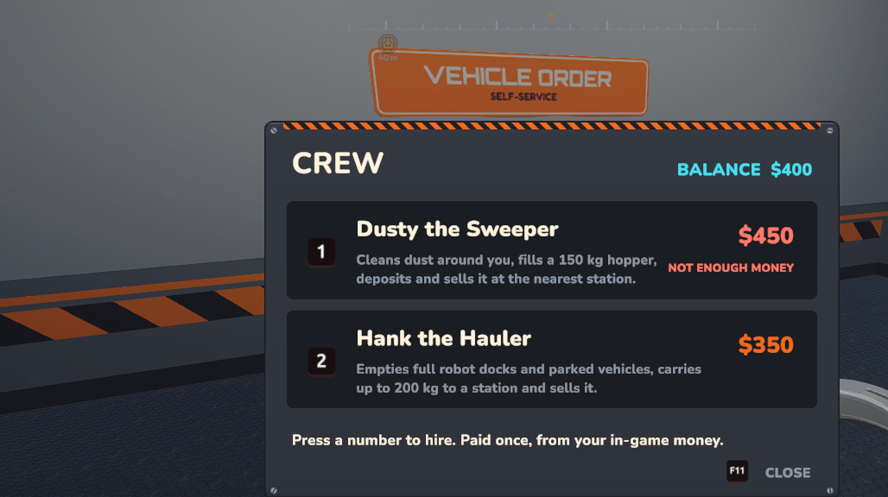
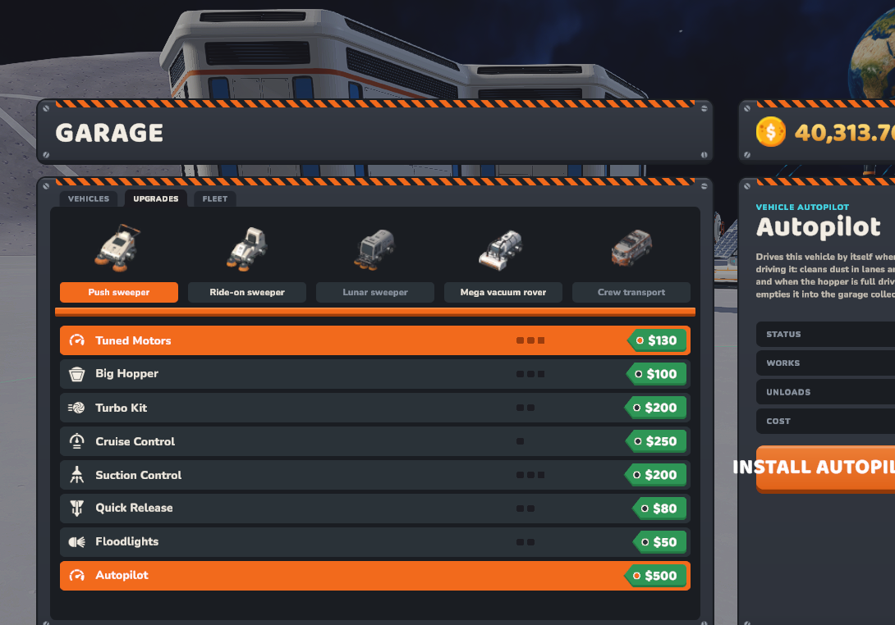
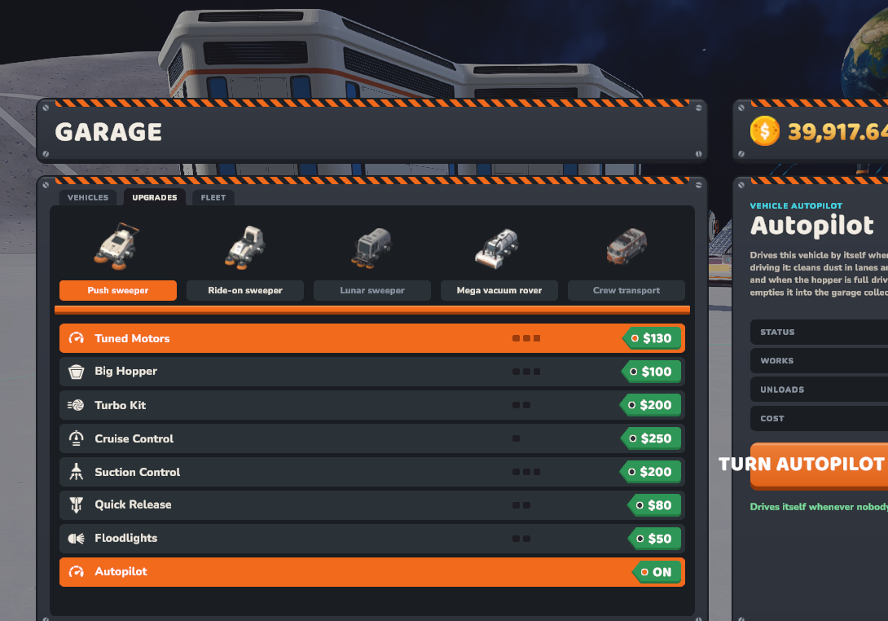
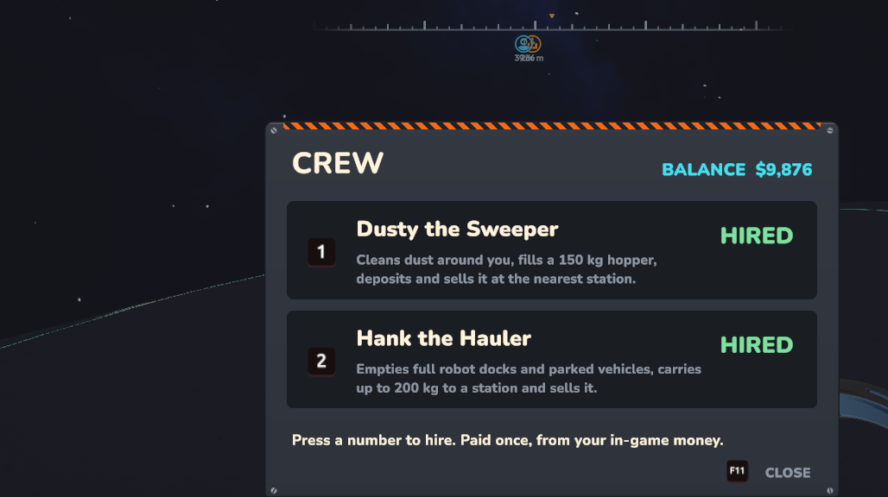
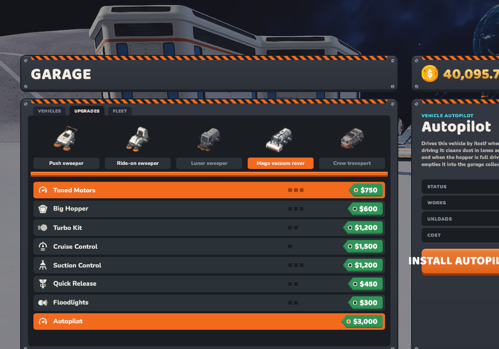
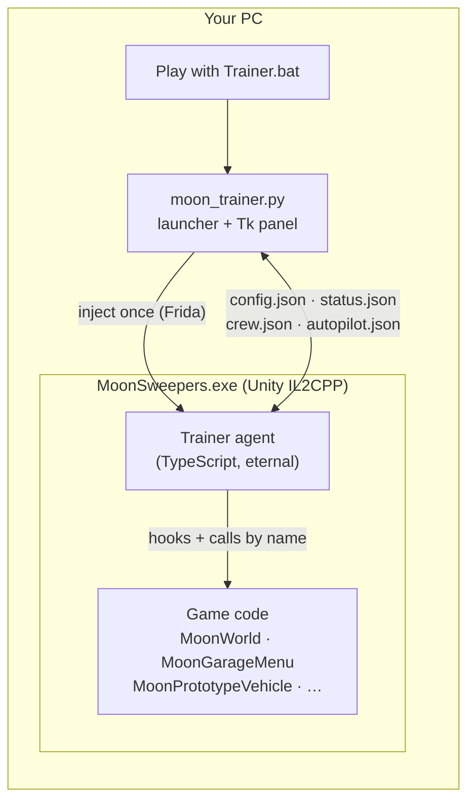
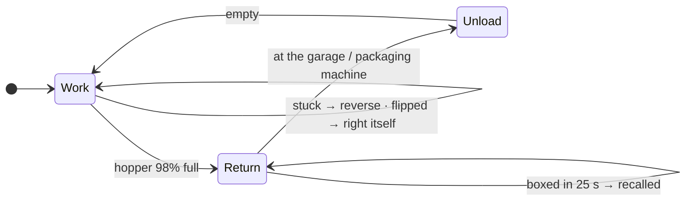
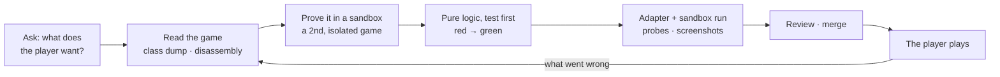

<div align="center">

# 🌙 Moon Sweepers: Crew & Autopilot

**A runtime mod for the Unity game *Moon Sweepers* that hires you a crew of AI helpers,
makes your vehicles drive themselves, and puts the game on fast-forward,
all without changing a single game file.**


[](LICENSE)



<sub>The crew window above is drawn with the game's own UI kit: same plates, fonts, keycaps and colours.</sub>

</div>

---

## Contents

- [What it does](#-what-it-does)
- [See it in the game](#-see-it-in-the-game)
- [Quick start](#-quick-start)
- [How it works](#-how-it-works)
- [The hard parts](#-the-hard-parts-and-how-they-were-solved)
- [How we worked](#-how-we-worked)
- [By the numbers](#-by-the-numbers)
- [What's next](#-whats-next)
- [Full write-up](docs/JOURNEY.md) · [Technical reference](docs/TECHNICAL.md)

---

## ✨ What it does

| | Feature | In one line |
|---|---|---|
| ⏩ | **Game speed** | Play at 0.5×–10× with hotkeys (F5/F6/F7) |
| 🧹 | **Dusty the Sweeper** | A hired astronaut who cleans dust around you and empties it into your packaging machine |
| 📦 | **Hank the Hauler** | Empties full robot docks and parked vehicles, so nothing sits idle |
| 🚗 | **Vehicle Autopilot** | A new upgrade for every vehicle: it cleans on its own and drives home to unload when full |
| 🤖 | **Robot bin boost** | Robot vacuums carry more and unload faster |
| 🗺️ | **Every flag on the map** | All 221 flags and landing sites shown, the ones you've raised dimmed |
| 🎛️ | **Control panel** | One window for every setting, live status, and the crew's switches |

<details>
<summary><b>🧹 Dusty the Sweeper</b> ($450): click to expand</summary>

- Cleans in 3 m lanes around you, starting within ~20 m and widening to 45, 75, 150 and 250 m as
  the nearer ground gets clean (a base swept by robots has no dust for a long way).
- A **dirt sensor** (a tiny-dose cleaning stroke that *weighs* what it picks up) skips clean lanes
  without walking them.
- Walks at **half your running speed**, around buildings, never under a roof.
- At 98% of a 150 kg hopper he walks to your **packaging machine** and loads it (it holds 100 kg;
  he keeps the rest for the next trip). No machine yet? He sells at a dust station instead.

</details>

<details>
<summary><b>📦 Hank the Hauler</b> ($350): click to expand</summary>

- Watches robot docks and parked vehicles. A dock that is **completely full** or a parked
  vehicle's hopper gets emptied into his 200 kg carrier.
- Never touches machine storage or a dock that still has room.
- Unloads into the packaging machine, like Dusty.

</details>

<details>
<summary><b>🚗 Vehicle Autopilot</b> ($1,000 × the vehicle's price scale): click to expand</summary>

- A new **Autopilot** row on every vehicle's **Upgrades** page in the garage, styled like the game's
  own rows. INSTALL once, then TURN OFF / TURN ON.
- Leave the vehicle somewhere dusty and get out: it drives itself with **real physics**, cleans in
  lanes of its own width around that spot, and at 98% full drives to the nearest garage and empties
  into the garage collector.
- Reverses out when stuck, rights itself when flipped, and is brought back to its garage if it is
  boxed in for 25 s. A vehicle stored in the garage is taken out automatically.
- Beyond ~500 m from you the game freezes parked vehicles (the ground there has no collision), so
  autopilot moves them along the terrain itself and keeps working.

</details>

---

## 📸 See it in the game

<table>
<tr>
<td width="50%"></td>
<td width="50%"></td>
</tr>
<tr>
<td align="center"><sub><b>A new upgrade row</b>: added under the game's seven, priced like them</sub></td>
<td align="center"><sub><b>Installed</b>: the tag turns ON and the button becomes a switch</sub></td>
</tr>
<tr>
<td width="50%"></td>
<td width="50%"></td>
</tr>
<tr>
<td align="center"><sub><b>F11 crew window</b>: both helpers hired, live balance</sub></td>
<td align="center"><sub><b>Scaled pricing</b>: $3,000 on the Mega vacuum rover, like its other upgrades</sub></td>
</tr>
</table>

---

## 🚀 Quick start

> **You need your own copy of Moon Sweepers.** No game files are included or modified.

<details>
<summary><b>Setup</b> (Windows, one time)</summary>

1. Copy your Moon Sweepers install into a folder named `game/` next to this README.
2. Create the Python environment and install Frida:
   ```bat
   py -3.12 -m venv tools\venv
   tools\venv\Scripts\pip install frida==17.2.3 frida-tools capstone pefile
   ```
3. Install the agent's packages:
   ```bat
   cd agent && npm install
   ```

</details>

<details open>
<summary><b>Play</b></summary>

Double-click **`Play with Trainer.bat`**. It starts the game (or attaches to a running one),
injects the trainer and opens the control panel.

| Key (in game) | Action |
|---|---|
| F5 / F6 / F7 | Slower / faster / back to 1× |
| F8 | Auto-deposit + auto-sell on/off |
| F9 | Robot bin boost on/off |
| F10 | Deposit your container now, from anywhere |
| F11 | Crew window (1 = hire Dusty, 2 = hire Hank) |

Autopilot is bought in the garage: **Upgrades** tab → pick a vehicle → **Autopilot** row → **INSTALL**.
Solo shifts only: in a crew session the host's game is in charge.

</details>

---

## 🧠 How it works

The game is a Unity **IL2CPP** build: C# compiled to native code, so there is no DLL to decompile.
The trainer is a **Frida** agent written in TypeScript with
[`frida-il2cpp-bridge`](https://github.com/vfsfitvnm/frida-il2cpp-bridge). It finds the game's own
classes and methods by name at runtime, hooks the few it needs, and calls the rest. It stays inside
the game process after injection, so closing the panel never crashes the game.



Helpers and vehicles are each split into a **pure brain**, unit-tested in Node with no game, and a
thin **game adapter** that reads the world, feeds the brain, and carries out its decision.



<details>
<summary><b>The building blocks</b> (click to expand)</summary>

| Module | Kind | Job |
|---|---|---|
| `crew/sweeper-brain.ts`, `hauler-brain.ts` | pure | What a helper does next |
| `crew/autopilot.ts` | pure | Vehicle steering, states, recall timer, garage pricing |
| `crew/lanes.ts` | pure | Cleaning lanes in rings on the curved moon, in ≤20 m segments |
| `crew/nav.ts` | pure | Sidesteps and wall-following round buildings |
| `crew/unload.ts`, `hires.ts`, `purchase.ts`, `window-model.ts` | pure | Unload target, hires per game, prices, window text |
| `crew/manager.ts`, `autopilot-driver.ts` | adapter | Drive bodies and vehicles in the game |
| `crew/world.ts`, `unity.ts` | adapter | Storages, raycasts, Decimal and value-type helpers |
| `crew/window.ts`, `garage-autopilot.ts` | adapter | UI built with the game's own kit |
| `sandbox.ts`, `probe.ts` | dev tools | Isolated second game; read and poke the live game |

</details>

---

## 🧗 The hard parts and how they were solved

Every one of these was found by watching the real game, not guessed. Click to see each.

<details>
<summary><b>💸 Money read as $7, so auto-deposit paid ~$0</b></summary>

`System.Decimal` returns were silently mis-marshalled by the bridge: the "$7 flag reward" was
garbage (the real one is $100). Fix: `callDecimal`, which calls the native method with a hidden
return-buffer pointer, plus raw 16-byte read/write of the Decimal layout. It also fixed a live bug
in auto-deposit.
</details>

<details>
<summary><b>👻 Values vanishing mid-use, windows stacking up</b></summary>

Structs built with `alloc().unbox()` live on the game's garbage-collected heap with nothing managed
pointing at them; the GC freed them mid-draw (access violations). They are now built in
Frida-owned memory. The F11 window "wouldn't close" for the same reason: the kit object was freed,
so closing read garbage and every redraw stacked a new window. Windows are now found by a unique
name, never by a kept reference.
</details>

<details>
<summary><b>🧭 The vehicle drove straight away from its target</b></summary>

Positive steer turns *left* in this game. With the sign wrong, "dead away from the target" becomes
the stable heading, so the car settled on it and drove 4 km in a straight line. Measured, flipped,
documented.
</details>

<details>
<summary><b>🧊 Vehicles frozen in place far from the player</b></summary>

Disassembly of `FixedUpdate`: an undriven vehicle over ground that isn't "solid" (terrain has
collision only ~500 m around you) is set kinematic and held still, so it doesn't fall through the
moon. Autopilot now has a remote mode that moves held vehicles along the terrain itself.
</details>

<details>
<summary><b>🌍 Lanes floating 22 m in the air, and walking on the spot</b></summary>

Lanes were planned on a flat plane through the player; the moon curves away (a 500 m lane's chord
runs ~30 m underground) and craters dip. Lanes are now projected onto the terrain and cut into
≤20 m segments.
</details>

<details>
<summary><b>🧱 Walking through buildings (and through themselves)</b></summary>

Knee-height raycasts see walls (this build strips `Linecast`, so it's `Raycast`), but terrain is a
collider too and so were the helpers' own bodies: every path read as blocked. Terrain and helper
bodies now pass through, a roof check catches halls on raised floors, and the navigator follows
walls round 40 m halls instead of giving up after one sidestep.
</details>

<details>
<summary><b>🧹 648,000 cells swept into a 0 kg hopper</b></summary>

The game counts every cell a stroke passes, dusty or not, so swept ground read as dirty forever.
The dirt sensor now weighs what it picks up, and the search widens to 250 m to find real dust.
</details>

<details>
<summary><b>🛒 The shop nobody could open</b></summary>

The first crew cards went into a shop that only opens at a Prototype Station and lists concept
cards only in prototype-testing mode (an inlined check, so it couldn't be hooked). The crew moved
to a native-looking F11 window and to the panel, and Autopilot lives in the garage's real
Upgrades page as a cloned row that never enters the game's own row list.
</details>

[More in the full write-up →](docs/JOURNEY.md#challenges)

---

## 🛠️ How we worked



- **Never touch the original game.** Work happens on a copy; the trainer patches nothing on disk.
- **A sandbox game** runs beside the real one with its file and registry access redirected, so
  experiments can't touch the real save.
- **Probes and screenshots**, not guesses: every claim about the game was checked in a running copy.
- **Test-first** for all decision logic: each bug above has a test that failed before its fix.
- **A fresh-eyes review** of the whole branch before it reached `main`.

---

## 📊 By the numbers

| | |
|---|---|
| Game files modified | **0** |
| Trainer + panel code | **~4,000 lines** |
| Automated tests | **121** agent + **9** panel |
| Crew modules | **19** |
| Bugs found in real game runs | each fixed test-first where the logic is testable, otherwise re-checked in the sandbox |

---

## 🗺️ What's next

- [ ] **Conveyor layout advisor**: suggest the belt layout that earns most for the machines you've placed
- [ ] **Blueprints** in the shop
- [ ] More crew: a **Driver**, a **Surveyor** and an **Architect**
- [ ] Smoother autopilot driving around crowded bases

---

<div align="center">
<sub>
A personal modding project, released under the <a href="LICENSE">MIT License</a>. Not affiliated with the developers of Moon Sweepers. Use in solo play.
Built with <a href="https://claude.com/claude-code">Claude Code</a>.
</sub>
</div>
