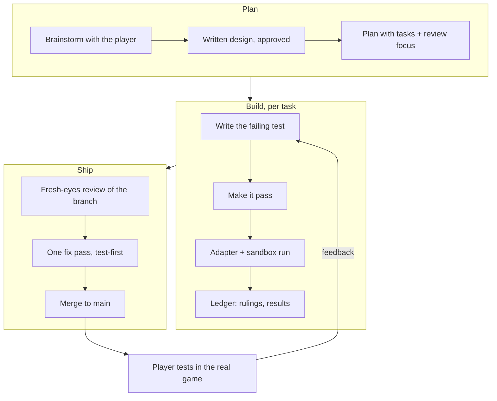

# The journey: building a crew and an autopilot for Moon Sweepers

This is the story of the project: why each piece exists, how it was built, what went wrong, and how
it was fixed. The short version is in the [README](../README.md); the reference is in
[TECHNICAL.md](TECHNICAL.md).

- [The goal](#the-goal)
- [Ground rules](#ground-rules)
- [Phase 1: speed and automation](#phase-1-speed-and-automation)
- [Phase 2: the crew](#phase-2-the-crew)
- [Phase 3: making the crew good](#phase-3-making-the-crew-good)
- [Phase 4: vehicle autopilot](#phase-4-vehicle-autopilot)
- [Challenges](#challenges)
- [Way of working](#way-of-working)
- [What we achieved](#what-we-achieved)
- [Lessons](#lessons)

---

## The goal

Moon Sweepers is a game about cleaning moon dust: sweep it up, carry it to stations, sell it, build
machines and robots that do more of it for you. The ask started small, *"make the game faster and
automate what you can"*, and grew, as play-testing does, into:

- helpers you **hire in the game** who work like you do,
- **every vehicle able to drive itself**,
- and all of it feeling like part of the game, not a cheat menu.

## Ground rules

Three rules were set on day one and never broken:

1. **Never touch the original game.** All work happens on a copy, and even the copy is never
   patched on disk. Everything happens at runtime, inside the running process.
2. **Prove it in the game.** Nothing about the game was assumed. Every claim was checked against a
   running copy with probes, logs and screenshots.
3. **Don't break the player's save.** Experiments run in a *sandbox*: a second copy of the game
   whose file and registry access is redirected to its own folder.

## Phase 1: speed and automation

The game is a **Unity 6 IL2CPP** build: C# compiled to native code. Its metadata version (0x6C) was
too new for the usual static dumpers, so classes were dumped **at runtime** with
`frida-il2cpp-bridge`, giving names, fields and method addresses for ~950 game types.

From there the first trainer was straightforward in principle:

- **Game speed**: set `Time.timeScale` every frame.
- **Multipliers**: wrap the game's own upgrade getters (walk speed, cleaning width, capacity…)
  instead of inventing values, so they stack with the player's upgrades.
- **Auto-deposit and auto-sell**: replay what the station does after its "is the player looking
  at me" check, and press the intake's sell button.
- **Every flag on the map**: make the map screen believe all 221 landmarks are raised while it
  draws, then dim the ones that really are.

Early lessons came fast. Killing the launcher crashed the game, because a Frida script dies with
its host. The fix: the agent is *eternalized* inside the game, and the launcher and panel only talk
to it through small JSON files. Robot vacuums "glitched" when sped up, because they clean in fixed
0.4 s strokes. So only their bin and unload rate are boosted, and the world's record of their bin
size is kept in sync (it had silently stayed at 40 kg).

## Phase 2: the crew

The idea: helpers who are *real astronauts* in the world, with their own suits and name tags, hired
with in-game money, who do the boring loop for you.

**Choosing who to build first.** From a longer list (Sweeper, Hauler, Driver, Surveyor,
Architect…), the Sweeper and the Hauler were picked: they cover the two biggest time sinks, cleaning
and emptying full robot docks. The rest went on the roadmap.

**Design decisions, and why:**

- **Bodies.** The game has a scripted "demo crew" system that draws remote-player astronauts.
  Helpers reuse it, so they look exactly like players. Their names come from a hook on the Steam
  lobby name lookup, answering only for two made-up IDs.
- **Brains are pure code.** Each helper is split into a *brain* (what to do next, with no game
  calls, unit-tested in Node) and an *adapter* (read the world, carry out the decision). That made
  most of the behaviour testable without a running game.
- **Their dust is real.** Hoppers are the game's own world storages, so they save and load with the
  world, and depositing credits the player exactly like a vehicle does.
- **Payback.** The goal was "pays for itself in about 20 minutes". The cleaning rate was tuned
  against measured yields: it holds on moderately dusty ground and not on sparse ground. That was
  recorded honestly rather than tuned to a number.

**Hiring** went through three designs before it felt right:

1. Cards in the game's upgrade shop. That shop turned out to open only at a Prototype Station, and
   it lists concept cards only in prototype-testing mode, so nobody could find the crew.
2. Buttons in the trainer panel. They worked, but weren't "in the game".
3. An **F11 crew window** drawn with the game's own UI kit (plates, fonts, keycaps), keyboard
   driven, with the tool belt's number keys blocked while it's open.

## Phase 3: making the crew good

Play-testing found what tests couldn't:

- **"Very slow."** Helpers walked at 1.4 m/s; the player runs at 11.2. Now: half the player's
  speed, including upgrades.
- **"Walks through buildings."** Helpers got a navigator with knee-height raycasts, sidesteps, wall
  following, and a roof check.
- **"Swept 648,000 cells into 0 kg."** The dirt sensor was counting cells instead of weighing dust.
- **"Use the packaging machine instead of selling."** Helpers now feed the packager's per-player
  stock directly, keep what doesn't fit, and fall back to a station only when no machine exists.

## Phase 4: vehicle autopilot

*"Every vehicle should have an autopilot upgrade in its own upgrades. It collects dust and when full
returns to the garage dust collector."*

**Research first.** Before writing any code, a read-only research pass mapped the garage's upgrade
page, the vehicle class, the garage collector and the money paths. It found that the game already
has an unused `Autopilot` flag on vehicles. That flag turned out to be a driver's
hold-the-throttle toggle, which doesn't help a parked car, so it isn't used.

**The approach that worked:**

- **Driving:** feed throttle, steering and brake into the vehicle's own physics step (a hook on
  `FixedUpdate`), so the game's suspension and tyres do the driving.
- **Cleaning:** strokes into the vehicle's own hopper, in lanes of its cleaning width.
- **Unloading:** with the game's `UnloadIntoGarage`, from open ground beside the garage. The
  unload pad sits deep inside a walled hall.
- **The upgrade:** a cloned row on the garage's real Upgrades page, priced with the game's own
  price scale.

The first sandbox run drove the car four kilometres in a perfectly straight line, away from where
it was meant to go. See [Challenges](#challenges).

---

## Challenges

Each one: what we saw → what was really happening → the fix.

| # | Symptom | Real cause | Fix |
|---|---|---|---|
| 1 | Launcher crash killed the game | Frida script tied to its host process | Eternalized agent + file IPC |
| 2 | Robot vacuums stopped cleaning when boosted | They clean in fixed 0.4 s / 0.3 m strokes | Boost bin and unload only; sync the world's bin record |
| 3 | Flag reward read as "$7"; auto-deposit paid ~$0 | `System.Decimal` returns mis-marshalled by the bridge | `callDecimal` with a hidden return buffer; raw Decimal read/write |
| 4 | Crew cards invisible in the shop | Shop opens only at a Prototype Station; concept cards listed only in test mode (inlined check) | Native F11 window built with the game's UI kit |
| 5 | Crew window wouldn't close; windows stacked | GC freed the kit object we kept; closing read garbage | Find the window by unique name; no kept references |
| 6 | Random access violations | Value types boxed on the GC heap with nothing managed referencing them | Build them in Frida-owned memory |
| 7 | Hires could vanish | A failed save-summary read looked like "new game"; panel and agent raced on `crew.json` | Unreadable ≠ empty; atomic writes; panel only flips pause flags |
| 8 | Helper "blocked" everywhere | Rays hit terrain and the helper's own body | Pass-through list; roof check for raised halls |
| 9 | Stuck walking a 40 m hall | One sidestep can't see round it | Wall following, longer look-ahead while going round |
| 10 | 0 kg after 648k cells | Cells counted, not dust | Sensor weighs the dust; search out to 250 m |
| 11 | Walking on the spot | Lanes on a flat plane, 22–30 m off the curved, cratered ground | Lanes projected to terrain, cut into ≤20 m segments |
| 12 | Car drove 4 km away from its target | Steering sign inverted: "away" became the stable heading | Measured and flipped `STEER_SIGN` |
| 13 | Car frozen far from the player | Game holds undriven vehicles still where ground has no collision | Remote mode moves held vehicles along the terrain |
| 14 | Car boxed in by kiln, press and belts | Lanes planned through a machine yard | Open-ground check; recall after 25 s without progress |
| 15 | Car orbiting a lane start | Can't turn tightly enough at 10.8 m/s | Ease off within 15 m; skip a lane start after 8 s |
| 16 | Autopilot bought but nothing happened | The vehicle was stored in the garage | Stored autopilot vehicles are taken out automatically |
| 17 | Autopilot rover went home to the swept base | Lanes centred on the garage | Lanes centred where the player leaves it |

Some debugging highlights:

- **Reading the game's own code.** Several answers came from disassembling single methods: the
  vehicle `FixedUpdate` that freezes cars on non-solid ground, the inlined `Listed` check that hides
  concept cards, the `Update` that showed the game's own autopilot flag is a driver's toggle.
- **Screenshots from a DirectX window.** Normal screen capture returned white, and Unity's
  screenshot hung under the sandbox's file redirection. `PrintWindow` with full-content rendering
  worked, and made every UI change checkable by eye.
- **Simulated key presses** drove the F11 window in the sandbox exactly as a player would.

## Way of working

- **Design before code.** Bigger features (the crew, the autopilot) started with questions, then a
  short written design the player approved.
- **A ledger of rulings.** Every decision taken without asking (a price, a colour, a fallback) was
  written down with *why* and *what it costs if wrong*, so it could be reviewed later.
- **Test-first for logic.** Brains, planners, pricing, file handling: each had a failing test before
  its code. Every bug in the table that lived in pure logic got a regression test.
- **The sandbox for everything else.** A second, isolated copy of the game with its own save, plus
  a probe script for reading and poking the live process, plus screenshots.
- **Read-only on the real game.** When something misbehaved in the player's game, it was inspected
  with read-only probes. Nothing in the live game was changed to debug it.
- **One independent review** of the whole branch before it reached `main`, followed by one fix pass.

## What we achieved

- An in-game **crew** you hire with in-game money: a Sweeper and a Hauler with their own suits and
  name tags, who clean, haul and feed your packaging machine.
- **Autopilot for every vehicle** as a real garage upgrade: physics driving, lane cleaning, unloading
  at the garage, recovery from getting stuck, and work far from the player.
- **Game speed, multipliers, auto-deposit and sell, robot boosts, a full landmark map**, and a control
  panel tying it together.
- **Zero game files modified**, the player's save never at risk, and 130 automated tests.

## Lessons

- **Watch the real thing.** Most of the important bugs were invisible to unit tests: a sign
  convention, a GC lifetime, a physics freeze, a curved moon. They showed up in the first minute of
  a sandbox run.
- **Measure before you fix.** "It's stuck" had four different causes over the project. Each time the
  answer came from adding one more measurement, not from a guess.
- **Keep the game's look.** Reusing the game's own UI kit and upgrade rows made the mod feel native,
  and was less code than drawing custom UI.
- **Say what isn't tested.** Where something couldn't be verified in the time available, the report
  said so, and the player's own play-test closed the gap.
